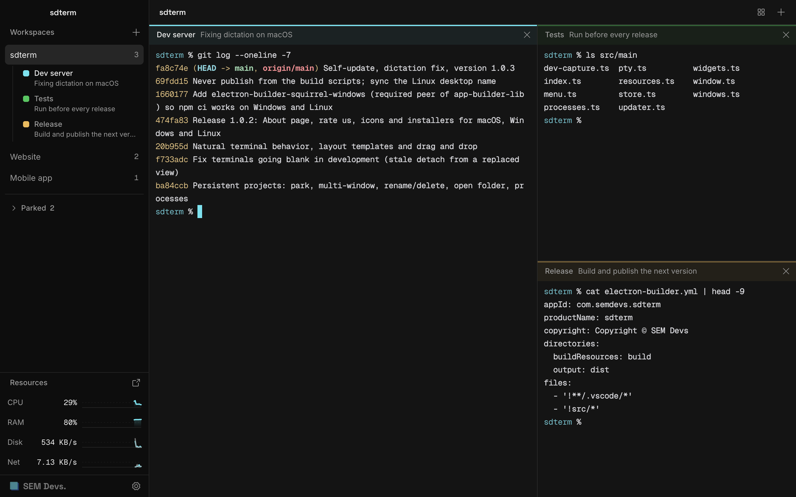
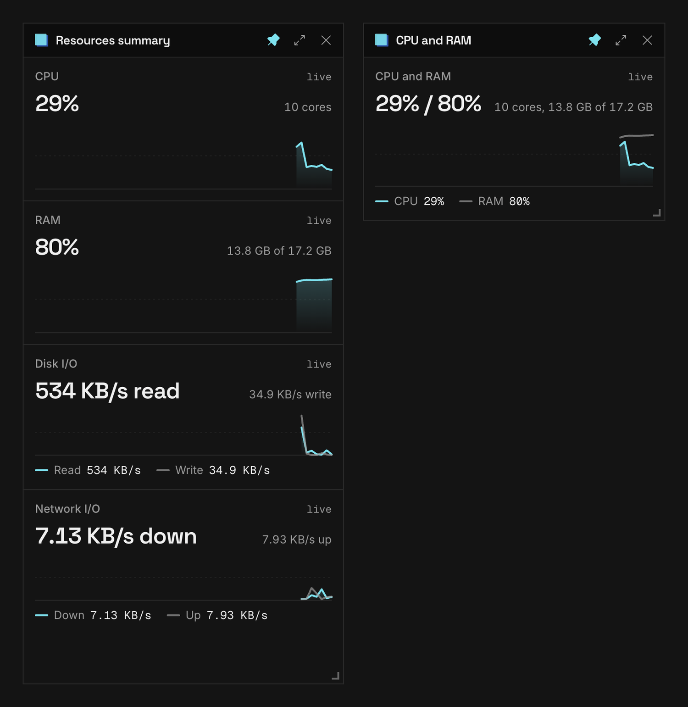

# sdterm

A terminal workspace for people who work on many projects at once. Free, by [SEM Devs](https://sem-devs.com).



## What it does

- **A name, a note and a color for every terminal.** Write what it is for and where you left off. You see it at a glance, in the title bar and in the sidebar.
- **Your projects come back.** Quit and reopen: every workspace, terminal, name and note is there, and each terminal starts again in the folder it was in.
- **Park what you are not working on.** A parked project stops its shells and costs nothing. Launch it again with one click.
- **More than one window.** Spread projects over several windows, pick a layout (columns, rows, grid, quarters, one big and a few small) and drag terminals to rearrange them.
- **Live monitors.** CPU, RAM, disk and network, plus a list of the busiest processes. Pop any of them out as a small window and keep it on top.
- **A normal terminal.** It runs your own shell with your own settings. Keys behave like Terminal.app on a Mac, macOS dictation works, and you can open any terminal's folder in Finder or Explorer.
- **Updates itself.** A small banner tells you when a new version is out.



## Download

Free for macOS, Windows and Linux: **[sem-devs.com/sdterm](https://sem-devs.com/sdterm)**

| System            | Versions                  |
| ----------------- | ------------------------- |
| macOS 12 or later | Apple Silicon and Intel   |
| Windows 10 and 11 | x64 and ARM64             |
| Linux             | AppImage and .deb, x86_64 |

The builds are not signed with a developer certificate yet, so the first launch shows a warning. On macOS, right-click the app and choose Open. On Windows, choose More info, then Run anyway.

## Why we built it

We work on many projects at the same time. After a few days we could not tell which terminal was for what, and every restart meant opening everything again by hand. We wanted one window that remembers what each terminal is for, where it was, and which projects we are not touching this week.

Tools like Wave showed that one window for many terminals is a good idea. We wanted something calmer and simpler, built around projects, that behaves like the terminal we already know. So we made it, we use it every day, and we are giving it away.

## Who we are

SEM Devs is a small technology studio in Bagnolo Mella, Italy. We build web and native apps and we secure the systems behind them. Our mission: make complex technology simple, secure and scalable, for businesses that cannot afford to slow down.

- Website: [sem-devs.com](https://sem-devs.com)
- LinkedIn: [linkedin.com/company/sem-devs](https://www.linkedin.com/company/sem-devs/)
- Email: [info@sem-devs.com](mailto:info@sem-devs.com)

## Build it yourself

You need Node.js 22.

```bash
git clone https://github.com/sem-devs/sdterm.git
cd sdterm
npm install
npm run dev
```

`npm run build:mac`, `build:win` and `build:linux` make the installers (Linux needs a Linux machine). Notes for developers are in [docs/development.md](docs/development.md).

## Contributing

Bug reports and pull requests are welcome. For anything else, write to info@sem-devs.com.

## License

MIT, see [LICENSE](LICENSE). The SEM Devs name and logo are trademarks of SEM Devs and are not covered by the license, see [TRADEMARKS.md](TRADEMARKS.md).
